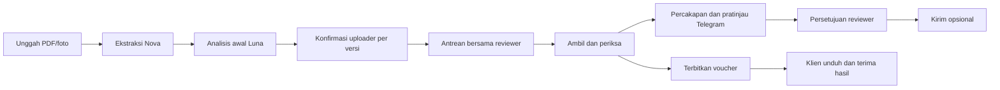

# AMIGA — API terbaru untuk partner review

Versi 4 · 16 Oktober 2026. Folder ini adalah proyek utama, dengan backend ZIP amiga-20261015T221710Z-1-001 sebagai sumber utama. Tidak ada backend kedua.

## Model dan tanggung jawab

- AWS Bedrock Nova Lite: pembacaan PDF/foto dan ekstraksi invoice.
- OpenAI GPT-6 Luna (`AGENT_MODEL=gpt-6-luna`): analisis awal uploader serta asisten uploader, reviewer dan admin. Semua panggilan berasal dari server, store=false, respons terstruktur dan keluaran dibatasi.
- Manusia: konfirmasi uploader, keputusan reviewer, persetujuan pesan Telegram, dan penerimaan/penutupan oleh klien. AI tidak mengubah izin, menyetujui voucher atau mengirim pesan sendiri.

## Format dan autentikasi

Base URL lokal: `/api`. Respons berhasil: `{"data":...}`. Error: `{"error":{"code":"...","message":"...","fields":{}}}`. JWT berada dalam cookie HttpOnly; mutasi memerlukan `X-CSRF-Token` dari `/auth/csrf`. Identitas dan peran berasal dari sesi, bukan parameter yang ditentukan model/browser.

Pendaftaran email biasa adalah klien. `/review` atau `/view` mengajukan reviewer; `/atmin` mengajukan admin. Reviewer memerlukan persetujuan admin satu kali. Telegram tidak wajib untuk daftar/login.

## Endpoint baru

| Metode dan path | Fungsi / payload penting |
|---|---|
| GET `/requests/{id}` | Menyertakan `initial_analysis`, `uploader_confirmation` per invoice, `ready_for_review`, dokumen sumber aktif dan ketersediaan Telegram |
| POST `/requests/{id}/invoices/{invoice}/confirm-uploader` | `{expected_version, acknowledged:true, item_count_confirmed:true}`; hanya uploader, setelah analisis awal READY |
| POST `/requests/{id}/invoices/{invoice}/initial-analysis/retry` | `{expected_version}`; antrekan ulang kegagalan, maksimal tiga upaya per versi, tunduk kuota harian |
| POST `/requests/{id}/document-revision` | Multipart: `invoice_file`, `reason`, `category`, `expected_versions` sebagai JSON, `supersede_published=true` wajib jika voucher aktif sudah terbit; PDF/foto baru, Request ID tetap |
| GET `/requests/{id}/voucher-history` | Daftar voucher arsip dari versi/sumber terdahulu |
| POST `/requests/{id}/vouchers/{voucher}/archive-download` | Unduh arsip sesuai akses request, tanpa handover hasil aktif |
| GET `/requests/{id}/telegram-deliveries` | Riwayat pengiriman milik reviewer yang sedang ditugaskan |
| GET `/agents/overview?request_id=...` | Konteks sesuai peran, prioritas deterministik; metrik reviewer hanya admin/service lead |
| GET `/agents/history?request_id=...` | Riwayat percakapan akun/peran/konteks saat ini |
| POST `/agents/chat` | `{question, request_id?}`; Luna menjelaskan data server; maksimal 1.000 karakter, jeda lima detik, kuota harian bersama analisis awal |
| GET `/telegram/status` | Status bot dan koneksi akun sendiri; tidak pernah mengembalikan bot token/chat ID |
| POST `/telegram/link` | Membuat tautan bot berisi challenge sekali pakai, berlaku 15 menit |
| POST `/telegram/verify` | Mencocokkan pesan `/start` private-chat dengan challenge; akun lain/group tidak dapat menggantikan penerima |
| DELETE `/telegram/link` | Memutus koneksi akun; pratinjau lama tidak berlaku |
| POST `/requests/{id}/invoices/{invoice}/telegram-preview` | `{expected_version, turn_id, include_voucher:false, message?}`; percakapan reviewer harus masih sesuai hasil tersimpan |
| POST `/telegram/previews/{preview}/send` | `{approved:true, preview_hash}`; mengirim persis pesan, penerima, versi dan lampiran yang dipratinjau |

Endpoint login, unggah awal, edit invoice, review, voucher, lifecycle, audit dan admin tetap tersedia pada kontrak lengkap [AMIGA_KONTRAK_API.md](AMIGA_KONTRAK_API.md).

## Aturan yang harus diperiksa partner

1. Tugas belum masuk antrean dan tidak dapat diambil/ditugaskan sebelum seluruh versi invoice aktif dikonfirmasi uploader. Reviewer tetap independen dari pengunggah, dan System Admin tidak dapat approve voucher.
2. Konfirmasi mengikat versi, item dan fingerprint data/bukti. Edit versi atau bukti membatalkan konfirmasi lama. Reviewer tetap menangani tugas yang sudah diambil sambil menunggu konfirmasi ulang.
3. Unggahan revisi mempertahankan dokumen, ekstraksi, review, voucher dan audit lama. Pointer sumber aktif berpindah ke file baru. CLOSED harus dibuka melalui permintaan revisi, dan voucher yang sudah terbit tidak ditimpa. Penggantian sumber OPEN dengan voucher terbit memerlukan persetujuan pengarsipan; unduhan arsip tidak mencatat handover aktif.
4. Telegram menggunakan penerima uploader yang sudah ditautkan, bukan username/chat ID bebas dari AI/browser. Lampiran hanya voucher resmi versi aktif. Mengedit pesan memerlukan pratinjau dan persetujuan baru; perubahan hasil, penugasan atau link penerima membatalkan pratinjau.
5. Pengiriman dicatat sebagai DRAFT → SENDING → SENT/FAILED/UNKNOWN. Timeout tidak diulang otomatis karena mungkin sudah terkirim. Pemanggilan berulang pada pratinjau SENT tidak mengirim lagi; tidak ada klaim exactly-once lintas jaringan.
6. Pengiriman Telegram tidak otomatis menutup pekerjaan atau menggantikan penerimaan klien. Kegagalan Telegram tidak menghilangkan hasil di website.
7. AI hanya mendapat konteks sesuai peran. Reviewer mendapat ringkasan tugas tersedia dan detail tugas miliknya; metrik kinerja seluruh tim hanya admin. Status, prioritas, tenggat dan metrik dihitung server.
8. Metrik selesai menghitung request dengan seluruh invoice aktif disetujui. Tanpa revisi memakai denominator pekerjaan yang telah diterima klien, tanpa permintaan revisi setelah penerbitan pertama; kategori kesalahan merupakan catatan manusia.

## Lokasi kode aktif

| Bagian | File |
|---|---|
| Factory, konfigurasi, lifecycle sesi | `backend/app.py`, `backend/application.py` |
| Controller utama ZIP + upload/konfirmasi/revisi | `backend/modules/upload/routes.py` |
| Worker ekstraksi / analisis awal | `backend/modules/upload/queue_worker.py`, `backend/initial_analysis.py` |
| Konfirmasi, sumber aktif, fingerprint | `backend/workflow.py` |
| Agent Luna, urgensi dan metrik | `backend/agent_service.py`, `backend/modules/agents/routes.py` |
| Telegram opsional | `backend/telegram_service.py`, `backend/modules/telegram/routes.py` |
| Model dan migrasi additive | `backend/models.py`, `migrations/004_agents_workflow.sql` |
| UI uploader / chatbot | `frontend/portal/src/js/uploader-workflow.js`, `agent-page.js` |
| Transport API frontend | `frontend/portal/src/js/api-client.js` |

Skema v4 menambahkan tujuh tabel. SQLite lokal bermigrasi additive saat startup; PostgreSQL memerlukan review dan penerapan migrasi eksplisit. Backup privat pra-perubahan tersimpan lokal dan tidak termasuk paket partner.

## Membuat paket untuk partner

Gunakan [Prepare-PartnerReview.ps1](Prepare-PartnerReview.ps1) ketika siap membuat ZIP. Script memakai daftar file yang diizinkan, sehingga `.env` privat, API key, database, dokumen klien, arsip ZIP sumber, runtime dan cache tidak ikut. Konfigurasi portabel ada di `backend/.env.example` dengan kolom rahasia kosong. Lihat [PARTNER_REVIEW.md](PARTNER_REVIEW.md).

Rujukan protokol: [OpenAI Structured Outputs](https://developers.openai.com/api/docs/guides/structured-outputs?api-mode=responses), [Telegram Bot API](https://core.telegram.org/bots/api), [Telegram deep linking](https://core.telegram.org/bots/features#deep-linking).

## Asisten berbentuk bubble

Tombol **Tanya AMIGA** berada di kanan bawah portal klien, reviewer dan admin. Klik untuk membuka chat tanpa meninggalkan invoice. Konteks mengikuti Request ID pada detail; **Request ID & konteks** dapat dipakai untuk mengganti fokus. Bagian prioritas, kinerja admin dan Telegram dapat dibuka-tutup; tutup bagian tersebut untuk kembali ke percakapan. Tombol ↗ membuka halaman asisten lengkap.

Bubble dapat ditutup dengan × atau Escape. Draf pertanyaan dipertahankan dalam memori selama sesi, terpisah per konteks; logout membersihkannya. Enter mengirim pesan dan Shift+Enter membuat baris baru. Mode terang/gelap, layar HP dan reduced motion tetap didukung. Model, scope akses dan persetujuan Telegram memakai API yang sama; menutup atau membuka bubble tidak memanggil model berbayar.
