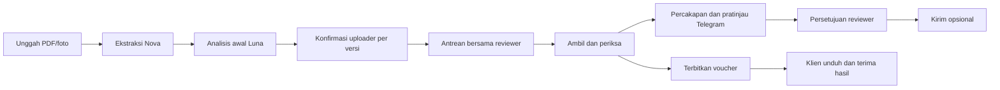

Pembaruan v7 lokal: schema7 additive, migration007. DTO request menambah request_code (REQ-YYYYMMDD-IDPERUSAHAAN-NAMA-URUTAN), company_number dan request_sequence; id UUID tetap. GET daftar dapat mencari kode; detail scoped dan konteks asisten menerima kode/UUID dengan izin yang sama. Plan pajak menambah withholding_amount opsional nullable: null/kosong memakai persentase, angka exact mengoreksi nominal PPh pada DEDUCT/REPLACE; KEEP mempertahankan source_withholding. Payload lama tetap diterima. Review-draft, optimistic revisions, PDF immutable dan persetujuan Telegram tetap berlaku. UI menambah klik dua kali/Enter, dialog alasan dan zoom PDF. Lihat PEMBARUAN_V7.md.

Pembaruan v6.5 PDF: renderer voucher menampilkan format uang Indonesia, tabel/total/catatan lebih rapi, tanggal lokal dan header/footer multipage. Payload/nilai API tetap decimal kanonis; tidak ada perhitungan baru. Berlaku pada PDF baru; arsip voucher resmi dan PDF manual yang sudah tersimpan tidak ditimpa. Lihat PEMBARUAN_V6.md.

Pembaruan v6.4 frontend: kolom utama PPN/PPh/total akhir dan kartu total menampilkan nominal efektif setelah penyesuaian. Basis sebelum pajak tetap field kanonis tersembunyi dalam details; koreksi nominal akhir dipetakan kembali ke basis sebelum dikirim bersama plan. Tidak ada perubahan API/schema atau penerapan pajak ganda. Subtotal tetap jumlah item. Lihat PEMBARUAN_V6.md.

Pembaruan v6.3 lokal: PATCH /api/requests/{request}/invoices/{invoice}/review-draft menerima expected_version, expected_tax_revision, acknowledged:true, plan, invoice opsional (fields, field_sources, item_count_confirmed, reason). Menyimpan invoice+pajak atomik untuk reviewer PIC independen; gagal salah satu rollback semuanya. Respons {invoice, voucher_tax, revision_created}. Endpoint lama tetap tersedia. Ringkasan pajak memakai draft terbaru dan berubah sebelum Simpan; PDF resmi memakai versi tersimpan. Lihat PEMBARUAN_V6.md.

Pembaruan v6.2 frontend: field uang memakai format berkelompok dan simbol mata uang; payload API tetap string decimal kanonis tanpa simbol/pemisah ribuan. Dropdown currency mengikuti nilai tersimpan dan tidak mengonversi kurs. Hitung otomatis pada buffer reviewer mengisi total baris/subtotal/total akhir, sebelum Simpan versi baru. Backend/schema/API tidak berubah.

Pembaruan v6.1 lokal: PATCH invoice mengizinkan tambahan reviewer PIC tanpa PDF baru, termasuk item dan rekening. field_sources header dapat memakai REVIEWER (document_id invoice konteks, page:null, notes alasan). Backend menetapkan sumber REVIEWER untuk perubahan reviewer tanpa bukti tambahan; uploader tidak dapat mengklaim sumber ini. POST approve menerima voucher_pdf_source: MANUAL atau GENERATED. GENERATED harus dipilih eksplisit untuk mengganti PDF manual; stale manual setelah pajak berubah tetap ditolak bila dipilih MANUAL. DTO menambahkan voucher_pdf_source untuk hasil resmi. Lihat PEMBARUAN_V6.md.

Pembaruan terbaru: [v6 — voucher revisi reviewer, sandi lokal, pajak dan tugas multiinvoice](PEMBARUAN_V6.md).

# AMIGA — API terbaru untuk partner review

## Pembaruan v5 lokal (menggantikan tujuan Klien/Telegram v4 di bawah)

- `POST /api/auth/register`: email biasa mendaftarkan Klien perusahaan dengan `company_name` wajib, `display_name`, password dan Telegram opsional. `/uploder` (alias `/uploader`) pada `email_input` mendaftarkan Uploader ACTIVE dengan workspace privat; Telegram penerima hanya Klien. Menghasilkan PENDING_COMPANY tanpa role/membership; hanya admin dapat menghubungkan perusahaan dan mengaktifkan COMPANY_CLIENT. `account_type` lama hanya diperiksa konsistensinya, tidak menimpa suffix; email biasa tidak dapat menjadi Uploader lewat payload. Login berikutnya memakai email biasa; `portal` bernilai uploader/client/reviewer/admin/pending.
- `PATCH /api/admin/clients/{id}`: `{name, expected_name}` untuk mengedit nama tanpa mengubah ID/akses perusahaan. Admin saja; tab usang 409.
- COMPANY_CLIENT eksklusif memakai membership untuk GET request/PDF/voucher; tidak dapat unggah, edit, konfirmasi uploader atau review. Handover dan lifecycle penerimaan/revisi layanan kini hanya COMPANY_CLIENT terkait; unduhan uploader bersifat internal. Status enam tahap ada di keduanya. Akun uploader tetap memakai CLIENT_OWNER/CLIENT_BACKUP sebagai kode internal.
- Telegram contact/link/status/verify hanya akun COMPANY_CLIENT. Request DTO menyertakan `telegram.recipients` berisi user_id/name/connected untuk akun perusahaan yang aktif. Pratinjau menerima `recipient_id`; wajib bila beberapa penerima terhubung. Tidak ada fallback ke uploader. Role, membership, link, versi, percakapan dan persetujuan diperiksa kembali saat kirim.
- `POST /api/requests/{id}/invoices/{invoice}/manual-pdf`: multipart `review_pdf`, `expected_version`, `expected_previous_id` (kosong untuk pertama), `content_confirmed:"true"`. Hanya reviewer PIC independen pada OPEN/idle/sebelum keputusan. PDF 10 MB/5 halaman mengikuti inspector yang sama; append-only dan tidak menjadi dokumen ekstraksi. Invoice DTO menyertakan `manual_review_pdf` beserta status signature.
- `GET /api/requests/{id}/invoices/{invoice}/manual-pdf/{pdf_id}`: unduhan manual internal untuk reviewer PIC. `POST` pada path tersebut ditambah `/signature`, body `{expected_version}`, memanggil Luna secara terbatas (maksimal 2 per file, kuota harian), dengan output DETECTED/NOT_DETECTED/UNCERTAIN/FAILED dan catatan. Tidak memblokir approval. Model tidak memverifikasi keaslian tanda tangan.
- Approval memakai blob manual terbaru untuk versi itu jika tersedia, atau renderer biasa bila tidak ada. Voucher resmi, versi lama dan manual terdahulu tidak ditimpa. Pengiriman Telegram melampirkan PDF resmi yang sama.

Schema v5 menambah `amiga_manual_review_pdfs`; migrasi PostgreSQL `migrations/005_company_manual_review.sql`. SQLite lokal dapat bermigrasi additive. Database demo lokal telah dikosongkan atas instruksi pengguna; hanya admin Gerardus/password lama dipertahankan, dengan cadangan privat di `.runtime-temp` yang tidak boleh dikemas.

Versi 4 · 16 Oktober 2026. Folder ini adalah proyek utama, dengan backend ZIP amiga-20261015T221710Z-1-001 sebagai sumber utama. Tidak ada backend kedua.

## Model dan tanggung jawab

- AWS Bedrock Nova Lite: pembacaan PDF/foto dan ekstraksi invoice.
- OpenAI GPT-6 Luna (`AGENT_MODEL=gpt-6-luna`): analisis awal uploader serta asisten uploader, reviewer dan admin. Semua panggilan berasal dari server, store=false, respons terstruktur dan keluaran dibatasi.
- Manusia: konfirmasi uploader, keputusan reviewer, persetujuan pesan Telegram, dan penerimaan/penutupan oleh klien. AI tidak mengubah izin, menyetujui voucher atau mengirim pesan sendiri.

## Format dan autentikasi

Base URL lokal: `/api`. Respons berhasil: `{"data":...}`. Error: `{"error":{"code":"...","message":"...","fields":{}}}`. JWT berada dalam cookie HttpOnly; mutasi memerlukan `X-CSRF-Token` dari `/auth/csrf`. Identitas dan peran berasal dari sesi, bukan parameter yang ditentukan model/browser.

Pendaftaran email biasa membuat klien langsung aktif. `/review` atau `/view` membuat reviewer langsung aktif tanpa approval; `/admin` mengajukan admin tambahan. Admin dapat menonaktifkan/mengaktifkan akun. Telegram tidak wajib untuk daftar/login. `telegram_contact` opsional pada pendaftaran klien menyimpan @username/Chat ID sebagai preferensi, bukan alamat kirim terverifikasi.

## Endpoint baru

| Metode dan path | Fungsi / payload penting |
|---|---|
| GET `/requests/{id}` | Menyertakan `initial_analysis`, `uploader_confirmation` per invoice, `ready_for_review`, dokumen sumber aktif dan ketersediaan Telegram |
| POST `/requests/{id}/invoices/{invoice}/confirm-uploader` | `{expected_version, acknowledged:true, item_count_confirmed:true}`; hanya uploader, setelah analisis awal READY |
| POST `/requests/{id}/invoices/{invoice}/initial-analysis/retry` | `{expected_version}`; antrekan ulang kegagalan, maksimal tiga upaya per versi, tunduk kuota harian |
| POST `/requests/{id}/document-revision` | Multipart: `invoice_file`, `reason`, `category`, `expected_versions` sebagai JSON, `supersede_published=true` wajib jika voucher aktif sudah terbit; PDF/foto baru, Request ID tetap |
| GET `/requests/{id}/voucher-history` | Daftar voucher arsip dari versi/sumber terdahulu |
| POST `/requests/{id}/vouchers/{voucher}/archive-download` | Unduh arsip sesuai akses request, tanpa handover hasil aktif |
| GET `/requests/{id}/telegram-deliveries` | Riwayat milik reviewer yang ditugaskan; System Admin dapat memantau seluruh pengiriman pada request |
| GET `/agents/overview?request_id=...` | Konteks sesuai peran, prioritas deterministik; metrik reviewer hanya admin/service lead |
| GET `/agents/history?request_id=...` | Riwayat percakapan akun/peran/konteks saat ini |
| POST `/agents/chat` | `{question, request_id?}`; Luna menjelaskan data server; maksimal 1.000 karakter, jeda lima detik, kuota harian bersama analisis awal |
| GET `/telegram/status` | Status bot, preferensi kontak dan koneksi akun sendiri; tidak mengembalikan token bot |
| PATCH `/telegram/contact` | `{contact}`: preferensi penerima uploader, boleh kosong; mengganti tujuan mencabut verifikasi lama |
| GET `/admin/telegram-bot` | Khusus System Admin: status, ID, username, revision; tanpa token |
| PATCH `/admin/telegram-bot` | `{token, expected_revision}`: verifikasi identitas/webhook, simpan file privat, tidak mengirim pesan; ID bot saja bukan credential |
| POST `/telegram/link` | Membuat tautan bot berisi challenge sekali pakai, berlaku 15 menit |
| POST `/telegram/verify` | Mencocokkan pesan `/start` private-chat dengan challenge; akun lain/group tidak dapat menggantikan penerima |
| DELETE `/telegram/link` | Memutus koneksi akun; pratinjau lama tidak berlaku |
| POST `/requests/{id}/invoices/{invoice}/telegram-preview` | `{expected_version, turn_id, message?}`; reviewer PIC atau System Admin; percakapan harus sesuai hasil tersimpan, voucher resmi aktif wajib dan PDF selalu disertakan |
| POST `/telegram/previews/{preview}/send` | `{approved:true, preview_hash}`; mengirim persis pesan, penerima, versi dan lampiran yang dipratinjau |

Endpoint login, unggah awal, edit invoice, review, voucher, lifecycle, audit dan admin tetap tersedia pada kontrak lengkap [AMIGA_KONTRAK_API.md](AMIGA_KONTRAK_API.md).

Salinan demo lokal: PATCH invoice mengembalikan `revision_created`. Jika data ternormalisasi, sumber field dan konfirmasi jumlah item efektif tetap sama, nilainya `false`: versi, konfirmasi uploader, analisis, resolusi dan voucher tidak berubah. Nilai `true` berarti revisi nyata dibuat dan konfirmasi uploader perlu diulang untuk versi baru. Konfirmasi jumlah item efektif memakai konfirmasi uploader yang masih cocok dengan fingerprint, atau `expected_item_count` versi saat ini. Semua pemeriksaan akses, request OPEN, input dan versi optimistis tetap dijalankan sebelum penentuan perubahan. Permintaan identik tidak otomatis mengonfirmasi data yang belum disetujui uploader.

## Aturan yang harus diperiksa partner

1. Tugas belum masuk antrean dan tidak dapat diambil/ditugaskan sebelum seluruh versi invoice aktif dikonfirmasi uploader. Reviewer tetap independen dari pengunggah, dan System Admin tidak dapat approve voucher.
2. Konfirmasi mengikat versi, item dan fingerprint data/bukti. Edit versi atau bukti membatalkan konfirmasi lama. Reviewer tetap menangani tugas yang sudah diambil sambil menunggu konfirmasi ulang.
3. Unggahan revisi mempertahankan dokumen, ekstraksi, review, voucher dan audit lama. Pointer sumber aktif berpindah ke file baru. CLOSED harus dibuka melalui permintaan revisi, dan voucher yang sudah terbit tidak ditimpa. Penggantian sumber OPEN dengan voucher terbit memerlukan persetujuan pengarsipan; unduhan arsip tidak mencatat handover aktif.
4. Bot AMIGA memberi tahu voucher sudah jadi dan mengirim PDF resmi aktif. Tujuan berasal dari private-chat Start yang terverifikasi, bukan nomor HP atau target bebas dari AI/browser. Kontak yang diisi harus cocok dengan akun yang menekan Start. Reviewer PIC dan System Admin dapat mengirim setelah percakapan, pratinjau dan persetujuan. Admin tidak mendapat izin approve voucher. Mengedit pesan atau mengubah hasil, penugasan, bot atau penerima membatalkan pratinjau. Penggantian bot meminta verifikasi penerima ulang.
5. Pengiriman dicatat sebagai DRAFT → SENDING → SENT/FAILED/UNKNOWN. Timeout tidak diulang otomatis karena mungkin sudah terkirim. Pemanggilan berulang pada pratinjau SENT tidak mengirim lagi; tidak ada klaim exactly-once lintas jaringan.
6. Pengiriman Telegram tidak otomatis menutup pekerjaan atau menggantikan penerimaan klien. Kegagalan Telegram tidak menghilangkan hasil di website.
7. AI hanya mendapat konteks sesuai peran. Reviewer mendapat ringkasan tugas tersedia dan detail tugas miliknya; metrik kinerja seluruh tim hanya admin. Status, prioritas, tenggat dan metrik dihitung server.
8. Metrik selesai menghitung request dengan seluruh invoice aktif disetujui. Tanpa revisi memakai denominator pekerjaan yang telah diterima klien, tanpa permintaan revisi setelah penerbitan pertama; kategori kesalahan merupakan catatan manusia.

## Lokasi kode aktif

| Bagian | File |
|---|---|
| Factory, konfigurasi, lifecycle sesi | `backend/app.py`, `backend/application.py` |
| Controller utama ZIP + upload/konfirmasi/revisi | `backend/modules/upload/routes.py` |
| Worker ekstraksi / analisis awal | `backend/modules/upload/queue_worker.py`, `backend/initial_analysis.py` |
| Konfirmasi, sumber aktif, fingerprint | `backend/workflow.py` |
| Agent Luna, urgensi dan metrik | `backend/agent_service.py`, `backend/modules/agents/routes.py` |
| Telegram opsional | `backend/telegram_service.py`, `backend/modules/telegram/routes.py` |
| Model dan migrasi additive | `backend/models.py`, `migrations/004_agents_workflow.sql` |
| UI uploader / chatbot | `frontend/portal/src/js/uploader-workflow.js`, `agent-page.js` |
| Transport API frontend | `frontend/portal/src/js/api-client.js` |

Skema v4 menambahkan tujuh tabel. SQLite lokal bermigrasi additive saat startup; PostgreSQL memerlukan review dan penerapan migrasi eksplisit. Backup privat pra-perubahan tersimpan lokal dan tidak termasuk paket partner.

## Membuat paket untuk partner

Gunakan [Prepare-PartnerReview.ps1](Prepare-PartnerReview.ps1) ketika siap membuat ZIP. Script memakai daftar file yang diizinkan, sehingga `.env` privat, API key, database, dokumen klien, arsip ZIP sumber, runtime dan cache tidak ikut. Konfigurasi portabel ada di `backend/.env.example` dengan kolom rahasia kosong. Lihat [PARTNER_REVIEW.md](PARTNER_REVIEW.md).

Rujukan protokol: [OpenAI Structured Outputs](https://developers.openai.com/api/docs/guides/structured-outputs?api-mode=responses), [Telegram Bot API](https://core.telegram.org/bots/api), [Telegram deep linking](https://core.telegram.org/bots/features#deep-linking).

## Asisten berbentuk bubble

Tombol **Tanya AMIGA** berada di kanan bawah portal klien, reviewer dan admin. Klik untuk membuka chat tanpa meninggalkan invoice. Konteks mengikuti Request ID pada detail; **Request ID & konteks** dapat dipakai untuk mengganti fokus. Bagian prioritas, kinerja admin dan Telegram dapat dibuka-tutup; tutup bagian tersebut untuk kembali ke percakapan. Tombol ↗ membuka halaman asisten lengkap.

Bubble dapat ditutup dengan × atau Escape. Draf pertanyaan dipertahankan dalam memori selama sesi, terpisah per konteks; logout membersihkannya. Enter mengirim pesan dan Shift+Enter membuat baris baru. Mode terang/gelap, layar HP dan reduced motion tetap didukung. Model, scope akses dan persetujuan Telegram memakai API yang sama; menutup atau membuka bubble tidak memanggil model berbayar.

## Telegram otomatis v8

`PATCH /api/telegram/automatic` menerima `{ "enabled": true }` atau false, memakai cookie/CSRF dan hanya akun COMPANY_CLIENT aktif itu sendiri. Aktif memerlukan private-chat terverifikasi pada bot saat ini. Respons mengikuti `/telegram/status` dengan tambahan `automatic_enabled`. Tidak menerima user_id/chat_id dari pemanggil. Mengaktifkan tidak membackfill voucher lama; nonaktif membatalkan antrean QUEUED milik penerima.

Approval tetap endpoint/izin/expected_version/tax_revision biasa. Secara atomik menambahkan TelegramDelivery QUEUED dan record unik `amiga_telegram_automatic_deliveries(voucher_id,recipient_id)` untuk penerima perusahaan opt-in. Worker existing mengirim byte Voucher.pdf sesudah commit dan pemeriksaan ulang kelayakan. QUEUED/SENDING/SENT/FAILED/UNKNOWN/CANCELLED; UNKNOWN terminal tanpa auto-retry. Tidak mencatat handover/menutup layanan.

Detail request untuk COMPANY_CLIENT menambah `telegram.automatic: {enabled,connected,items:[{invoice_id,version,state,created_at,sent_at,error_code}]}` yang hanya memuat pengiriman milik pemanggil. Riwayat reviewer/admin existing menambah `automatic` boolean pada DTO delivery. Pengiriman manual tidak boleh menduplikasi voucher+penerima dengan job otomatis QUEUED/SENDING/SENT/UNKNOWN. Tidak mengubah kontrak pratinjau manual.

SQLite schema8 additive startup; PostgreSQL jalankan `migrations/008_automatic_telegram.sql` sesudah007. `backend.telegram_automatic` memuat enqueue dan processor, bukan endpoint bypass approval. Transport tes tetap hanya diizinkan ketika TESTING=True.
