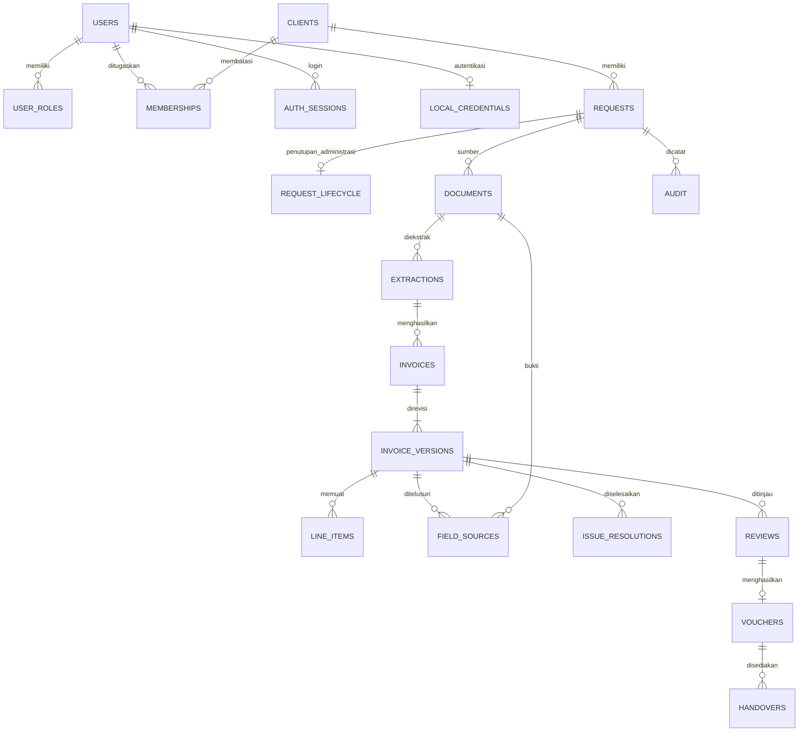

# Skema relasional AMIGA (3NF)

Normalisasi mengatur penyimpanan, integritas, dan riwayat; normalisasi tidak meningkatkan kemampuan membaca PDF. Akurasi tetap memerlukan OCR yang sesuai, sumber dokumen, validasi Decimal, serta review manusia. Tidak ada tuntutan BCNF tambahan.

| Tabel | Kunci | Isi dan hubungan |
|---|---|---|
| amiga_settings | key | Versi skema dan status bootstrap pertama |
| amiga_users | id, email unique, google_sub unique | Identitas, nama dan status akun |
| amiga_local_credentials | user_id PK/FK | Hash bcrypt, counter kegagalan, batas lockout, izin bootstrap dari operator lokal dan waktu perubahan; tidak ada password mentah |
| amiga_user_roles | user_id + role | Banyak peran per pengguna; tanpa daftar role dalam satu kolom |
| amiga_clients | id | Nama klien |
| amiga_memberships | user_id + client_id | Penugasan akun ke klien |
| amiga_auth_sessions | token_hash | Sesi server, pengguna dan kedaluwarsa; tidak menyimpan token mentah |
| amiga_requests | id | Klien, pengunggah, PIC, metadata dan status pemrosesan |
| amiga_request_lifecycle | request_id PK/FK | OPEN/CLOSED, revision untuk konkurensi, aktor dan waktu transisi terakhir; request lama tanpa baris berarti OPEN revisi 0 |
| amiga_documents | id, storage_key unique | Request, jenis dokumen, hash, pemilik unggahan dan metadata file |
| amiga_extractions | id | Percobaan ekstraksi, dokumen sumber, waktu, output asli immutable |
| amiga_invoices | id | Request, ekstraksi/generasi, indeks, versi aktif; invoice lama tidak dihapus saat ekstraksi ulang |
| amiga_invoice_versions | invoice_id + version | Header invoice, alasan, pembuat versi, jumlah item yang dikonfirmasi |
| amiga_line_items | invoice_id + version + index | Seluruh item pada versi tertentu; FK komposit ke versi |
| amiga_field_sources | invoice_id + version + field | Sumber dokumen per field, jenis, halaman dan catatan; FK komposit ke versi |
| amiga_issue_resolutions | invoice_id + version + issue_code | Resolusi reviewer beralasan pada versi tertentu |
| amiga_reviews | id | Versi, reviewer, keputusan, waktu dan snapshot validasi |
| amiga_vouchers | id; invoice_id + version unique | Review sumber, PDF resmi immutable, hash PDF dan waktu |
| amiga_handovers | id | Penyediaan unduhan voucher oleh aktor dan waktu; tidak menyatakan pembayaran |
| amiga_audit | id | Peristiwa aktor/request/invoice, waktu, alasan serta before/after |

Header invoice tidak mengulang nama klien, email uploader atau nama reviewer. Identitas tersebut dirujuk dengan foreign key. Daftar item, role, assignment dan sumber field memiliki baris tersendiri. Review tidak dipakai sebagai status pembayaran.

Nilai uang disimpan sebagai string decimal kanonik pada kolom scalar dan dihitung dengan Python Decimal, termasuk pada SQLite. Ini menghindari konversi binary float oleh SQLite. Validasi aplikasi membatasi format, ukuran dan nilai nonfinite; schema kolom bukan pengganti validasi input. Kuantitas, diskon dan pajak unknown tetap null.

JSON hanya digunakan untuk arsip output model/OCR yang tidak diubah, snapshot validasi review dan payload peristiwa audit. JSON tersebut adalah rekaman historis, bukan tabel utama invoice/item yang terus ditimpa. PDF resmi disimpan sebagai bytes snapshot, sedangkan sumber PDF privat berada di disk.

`migrations/001_workspace.sql` dihasilkan dari metadata SQLAlchemy untuk PostgreSQL tanpa koneksi database. Script bersifat additive, hanya `amiga_*`, tanpa DROP/DELETE tabel lama. `create_all` bukan alat upgrade skema untuk perubahan berikutnya: perubahan pasca-v1 harus mempunyai migrasi yang ditinjau tersendiri. Server biasa tidak membuat tabel PostgreSQL otomatis.

Versi 2 menambahkan tabel ke-19, amiga_local_credentials, melalui `migrations/002_local_auth.sql`. Migrasi ini tidak mengubah invoice, user, role atau data legacy. SQLite pengembangan memakai create_all untuk penambahan tabel ini lalu menaikkan versi 1 ke 2; tidak ada perubahan kolom existing. PostgreSQL memerlukan migrasi eksplisit. Kredensial terpisah menjaga akun Google lama tanpa password tetap valid dan mencegah pendaftaran publik memasang password pada akun existing. JWT cookie membawa identitas; amiga_auth_sessions hanya menyimpan hash token dan waktu kedaluwarsa untuk revokasi.

Data lama pada `queue_items` / `invoice_records` belum mempunyai pemetaan tenant/aktor yang memadai. Jangan menebak klien dari nama file atau email ilustrasi. Pemilik harus menetapkan mapping tenant/aktor, meninjau hasil impor pada backup/staging, lalu mengizinkan migrasi data secara eksplisit. Data lama tetap tersimpan dan route HTTP tanpa auth telah dinonaktifkan.

Status request dan total per mata uang dihitung dari versi/review/handover aktif, bukan mencampurkan mata uang atau menganggap approval sebagai PAID. Implementasi list saat ini menghitung status/validasi per request sebelum pagination; optimasi query untuk data besar memerlukan pengukuran tersendiri.

## Versi 3: penutupan layanan

20 tabel. `003_request_lifecycle.sql` menambah satu tabel tanpa mengubah kolom/data historis. SQLite pengembangan membuat tabel baru dan menaikkan versi 1/2 ke 3 saat startup; PostgreSQL perlu migrasi berurutan 001 → 002 → 003 atau inisialisasi operator yang eksplisit. Tes upgrade dari database v2 mempertahankan request lama.

State administratif tidak menggandakan status validasi invoice. `work_status` merupakan hasil perhitungan status pemrosesan, penugasan, keputusan review, handover dan lifecycle. Penutupan/revisi mengunci request induk dan memeriksa revision lifecycle beserta semua versi invoice, agar penutupan tidak dapat menimpa perubahan dari tab lain. Revisi membuat versi baru, tanpa menghapus approval, voucher, atau handover terdahulu.
